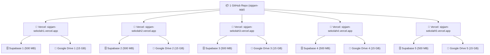

# Panduan Implementasi: Deploy SIPJAM untuk 5 Sekolah Besar (100% Gratis)

Panduan ini menjelaskan cara menerapkan **Opsi 1** (Arsitektur Multi-Instance Mandiri). Setiap sekolah memiliki database Supabase dan Google Drive sendiri, namun Anda **hanya mengelola 1 repositori GitHub dan 1 codebase**.

---

## 🏗️ Gambaran Arsitektur



### Keuntungan Utama:
1. **Total Kuota Efektif**: **2,5 GB Database PostgreSQL** (5 $\times$ 500 MB) & **75 GB Penyimpanan Foto** (5 $\times$ 15 GB) — **Semuanya Rp 0 (100% Gratis)**.
2. **Isolasi Data Penuh**: Data siswa dan guru antar sekolah terpisah 100% (memenuhi standar kepatuhan privasi data pendidikan).
3. **Pembaruan Serentak (Zero Maintenance)**: Cukup lakukan `git push origin main`, Vercel akan otomatis memperbarui aplikasi di kelima sekolah secara bersamaan.

---

## 📋 Langkah Provisi per Sekolah (Hanya 5 Menit)

Ulangi 4 langkah cepat ini untuk masing-masing sekolah:

### Langkah 1: Buat Project Supabase Gratis
1. Buka [Supabase Dashboard](https://supabase.com/dashboard).
2. Buat project baru (pilih Region terdekat: **Singapore**).
3. Catat:
   * **Project URL**: `https://<project-id>.supabase.co`
   * **Anon / Public Key**: di menu *Project Settings -> API*
   * **Database Password**: password yang Anda tentukan saat membuat project.

---

### Langkah 2: Inisialisasi Database (Pilih Salah Satu Cara)

#### Cara A: Otomatis via Terminal (Paling Cepat)
Jalankan perintah ini di terminal proyek:
```bash
node scripts/provision-new-school.js
```
Masukkan URL koneksi Supabase Anda, nama sekolah, NPSN, dan password admin. Script akan mengeksekusi seluruh 31 tabel, view, indeks, dan trigger secara otomatis.

#### Cara B: Manual via Supabase SQL Editor
1. Buka menu **SQL Editor** di dashboard Supabase sekolah tersebut.
2. Buka file [`supabase/SETUP_NEW_SCHOOL_TEMPLATE.sql`](../supabase/SETUP_NEW_SCHOOL_TEMPLATE.sql), salin seluruh isinya.
3. Tempel (*paste*) ke SQL Editor Supabase, lalu klik tombol **Run**.
4. Database sekolah langsung siap digunakan dengan akun default:
   * **Username**: `admin`
   * **Password**: `admin123`

---

### Langkah 3: Siapkan Google Drive untuk Penyimpanan Foto
Agar kuota foto (selfie presensi & bukti jurnal) masuk ke Google Drive sekolah tersebut:
1. Buka akun Google sekolah (Drive gratis 15 GB).
2. Kunjungi [script.google.com](https://script.google.com/) lalu buat **New Project**.
3. Buka file [`scripts/google-drive-webhook.gs`](../scripts/google-drive-webhook.gs), salin isinya, dan tempel ke editor Google Apps Script.
4. Klik **Deploy** -> **New deployment**:
   * Tipe: **Web app**
   * Execute as: **Me**
   * Who has access: **Anyone** (Wajib agar dapat menerima kiriman foto dari aplikasi).
5. Klik **Deploy**, beri izin akses (*Review Permissions*), dan salin **Web app URL** yang muncul (berakhiran `/exec`).

---

### Langkah 4: Hubungkan ke Vercel (Hobby Free)
1. Buka [Vercel Dashboard](https://vercel.com/dashboard) -> **Add New...** -> **Project**.
2. Pilih repositori GitHub `sipjam-app` Anda.
3. Beri nama project sesuai nama sekolah (misal: `sipjam-sman1modayag`).
4. Di bagian **Environment Variables**, tambahkan 3 variabel:
   * `NEXT_PUBLIC_SUPABASE_URL` = `https://<project-id>.supabase.co`
   * `NEXT_PUBLIC_SUPABASE_ANON_KEY` = `<anon-key-supabase>`
   * `NEXT_PUBLIC_DRIVE_UPLOAD_WEBHOOK_URL` = `<url-webhook-google-drive>`
5. Klik **Deploy**!
6. Sekolah tersebut kini memiliki URL aktif sendiri (misal: `https://sipjam-sman1modayag.vercel.app` atau domain sekolah kustom seperti `absen.sman1modayag.sch.id`).

---

## 🛡️ Tips Agar Tetap Aktif Selamanya (Mencegah Auto-Pause)

Supabase Free Tier akan membekukan (*pause*) database jika tidak ada aktivitas selama 7 hari (misal saat libur semester).
Untuk mencegah hal ini:
1. Buka layanan gratis [UptimeRobot.com](https://uptimerobot.com/).
2. Buat **New Monitor**:
   * Monitor Type: `HTTP(s)`
   * Friendly Name: `SIPJAM SMAN 1`
   * URL: URL aplikasi Vercel sekolah tersebut (misal: `https://sipjam-sman1modayag.vercel.app`)
   * Monitoring Interval: Setiap 6 atau 12 jam.
3. Aplikasi akan terus menerima ping ringan setiap hari sehingga database Supabase **tidak akan pernah di-pause**.
